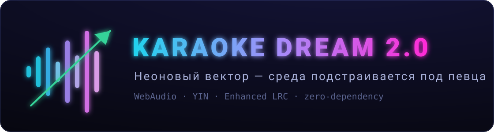

<div align="center">



# KARAOKE DREAM 2.0

**Браузерное караоке мечты: неон, гид-вокал, оценка голоса в реальном времени и «Зелёный коридор» — среда подстраивается под певца, а не певец под среду.**

[](https://github.com/rtynbirf/karaoke-dream/actions/workflows/ci.yml)
[](LICENSE)
[](package.json)
[](package.json)
[](CONTRIBUTING.md)

*Live-демо: <https://rtynbirf.github.io/karaoke-dream/> · микрофон требует HTTPS (GitHub Pages подходит)*

</div>

---

> Среда не двигает вектор — она меняет цену шага.
> Ученик = вектор: v(t+1) = v(t) + Δv. Большинство караоке требует от вектора соответствия тренду.
> Здесь наоборот: проваливаешь строки — **сцена транспонируется к тебе**. Выравниваешься — возвращается к оригиналу.
> Это «Зелёный коридор» — то, чего нет в трендах: r = ТЫ − E(тренды) максимален.

## Что умеет прототип

| Слой | Возможность | Статус |
|---|---|---|
| Контент | Демо-песня «Неоновый вектор» — синтез минуса прямо в браузере (пэд, бас, ударные) | готово |
| Контент | Свой трек (mp3/wav/ogg) + своя лирика (Enhanced LRC) | готово |
| Контент | Минус-вокал: вычитание центрального канала | готово |
| Комфорт | Гид-мелодия с живой громкостью; сдвиг тональности без изменения темпа | готово |
| Обратная связь | Pitch-детектор **YIN**; кривая голоса поверх нот-плашек на canvas | готово |
| Обратная связь | Оценка 0–100: точность / ритм / стабильность; режимы «Дружелюбный» и «Жюри» | готово |
| Сингулярное | **«Зелёный коридор»**: при просадках −1 пт за строкой (до −3), при росте — возврат; допуски растут с глубиной | готово |
| Вечеринка | Очередь певцов, лидерборд, «большой экран» | готово |
| Атмосфера | Неон-тема, тосты, reduced-motion, всё локально — голос не покидает браузер | готово |
| След. фазы | ML-стемы (Demucs ONNX), MIDI-эталоны, сетевые комнаты, телефон-пульт | roadmap → `docs/04-roadmap.md` |

## Быстрый старт

```bash
git clone https://github.com/rtynbirf/karaoke-dream.git
cd karaoke-dream
npm run dev        # → http://localhost:5173 (микрофон работает на localhost)
```

Альтернатива без npm: `python3 -m http.server 5173` в корне репо. Или просто открой GitHub Pages (ссылка выше).

Дальше: **Демо-песня → включи микрофон → «На сцену»**. Пой гид-мелодию: розовая кривая должна держаться внутри голубых плашек. Всё. Остальное среда сделает сама.

Для своего трека: **Свой трек → mp3 + LRC-текст → «убрать вокал» при желании**. Без LRC — свободный режим с осциллографом активности.

## Как это работает

```
микрофон ──► AnalyserNode ──► YIN-детектор ──► кадры {t, midi, voiced}
                                                     │
демо: синтез офлайн        свой трек: decode + (L−R)/√2
(пэд+бас+ударные) +                │
гид-мелодия (отдельный слой)       ▼
        │                    судья: медиана/MAD по окнам слов
        ▼                          │  total = точность+ритм+стабильность
AudioEngine (2 слоя, detune) ◄── «Зелёный коридор» (политика ±3 пт)
        │
        ▼
колонки + неон-UI: подсветка слов, питч-трейл, HUD, очередь
```

- **YIN** (de Cheveigné & Kawahara) — классический детектор высоты тона: функция разности → кумулятивная нормировка → параболическая интерполяция. Чистый JS, ~0.8 млн операций на кадр, без библиотек.
- **Судья** — устойчивая статистика: медиана и MAD вместо среднего/SD, чтобы кадры соседних слов на границах окон не рушили оценку.
- **Enhanced LRC** — пословные тайминги; парсер/сериализатор в ~100 строк; для строк без тегов тайминги распределяются по весу слов.
- **Коридор** — транспозиция через `detune` (темп сохраняется; фолбэк — `playbackRate`), эталон оценки и визуализация читают одно и то же смещение.
- **Демо-песня синтезируется**, а не поставляется файлом: тональность — параметр, бинарников в репо нет, текст и ноты происходят из одного источника (`src/js/songs/demo.js`).

Честные ограничения прототипа: минус-вокал методом центр-канала не справляется с широкими сведениями (ML-стемы — фаза 2); оценка точности питча для своих треков появится с MIDI-эталонами; сетевые комнаты — фаза 3. Подробно — в ТЗ.

## Документы (канон проекта)

| Документ | Содержание |
|---|---|
| [`docs/01-concept.md`](docs/01-concept.md) | концепция 2.0: 5 слоёв, критерии, рыночный анализ, сингулярное |
| [`docs/02-tz.md`](docs/02-tz.md) | ТЗ: 25 FR, 10 NFR, критерии приёмки, риски |
| [`docs/03-architecture.md`](docs/03-architecture.md) | архитектура: диаграммы, аудио-пайплайн, ADR-1…5, бюджеты |
| [`docs/04-roadmap.md`](docs/04-roadmap.md) | фазы 0–5, зависимости, KPI |
| [`docs/05-implementation.md`](docs/05-implementation.md) | пакет реализации: соглашения, DoD, чек-лист, точки роста |

## Структура репозитория

```
index.html            # SPA-оболочка
src/js/lyrics/        # LRC-парсер, синхронизация (чистая логика)
src/js/scoring/       # судья + Зелёный коридор (чистая логика)
src/js/songs/         # демо-композитор — единый источник правды
src/js/audio/         # WebAudio-движок, синтезатор, YIN
src/js/ui/            # экраны, питч-трейл (DOM/canvas)
src/js/main.js        # оркестратор
tests/                # node:test — 21 тест чистой логики
scripts/              # smoke-импорт всех модулей в Node
docs/                 # канон: концепция → ТЗ → архитектура → roadmap → реализация
```

## Разработка

```bash
npm run dev     # локальный сервер (serve через npx)
npm test        # unit-тесты чистой логики (Node ≥ 18, без зависимостей)
npm run smoke   # все ES-модули импортируются в Node
```

CI: GitHub Actions, матрица Node 18/20/22, прогон — секунды. Подробный канон вклада — [`CONTRIBUTING.md`](CONTRIBUTING.md); безопасность и приватность — [`SECURITY.md`](SECURITY.md); журнал — [`CHANGELOG.md`](CHANGELOG.md).

## Приватность

Голос и файлы обрабатываются **исключительно в браузере**: ни одного сетевого запроса после загрузки страницы. Настройки, очередь и лидерборд живут в `localStorage`. Это не недоделка, а принцип — см. NFR-4 в ТЗ.

## Лицензия

MIT — [`LICENSE`](LICENSE).

---

<div align="center">

*«Я пою там, где тренды молчат» — демо-песня прототипа.*

</div>
