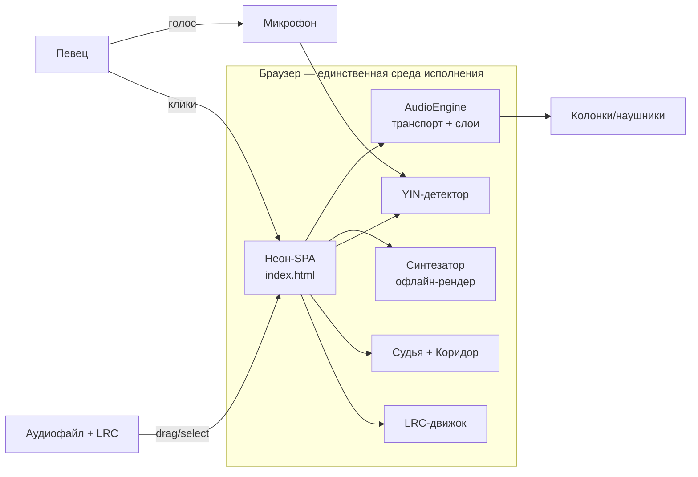
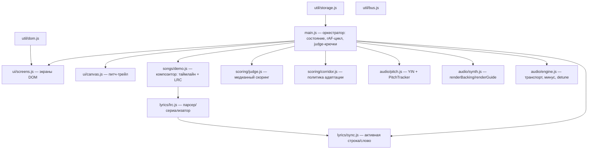
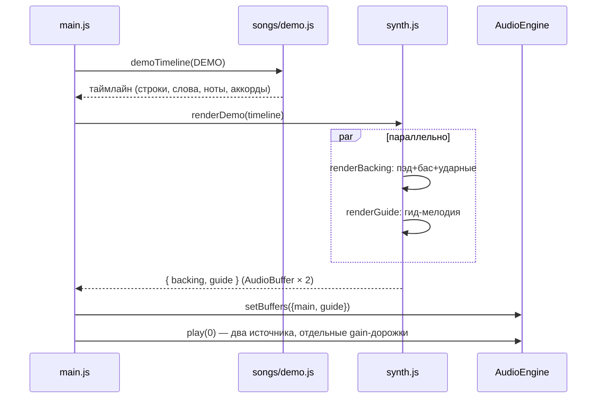
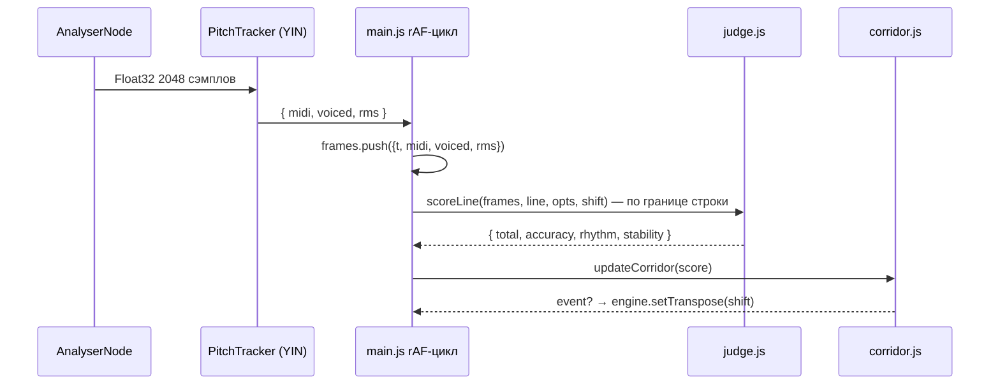

# Архитектура: KARAOKE DREAM 2.0

## 1. Контекст



Внешних сервисов нет: сеть не используется вовсе. Хранилище — `localStorage` (настройки, очередь, лидерборд).

## 2. Компоненты



Правило зависимостей: `ui → чистая логика → ничего`. Чистая логика (`lyrics`, `scoring`, `songs`, `audio/pitch`) не знает ни про DOM, ни про AudioContext — поэтому тестируется в Node без браузера.

## 3. Аудио-пайплайн

### 3.1 Подготовка демо



### 3.2 Контур реального времени (каждые ~80 мс)



### 3.3 Транспозиция коридора

Сдвиг применяется как `detune = semis × 100` центов к обоим буферным источникам — темп и длительность сохраняются. Фолбэк для браузеров без `detune` — `playbackRate = 2^(s/12)` (меняет и темп; задокументировано). Эталон оценки, ноты-плашки canvas и HUD читают один и тот же `session.transpose`, рассинхрон невозможен.

## 4. Модель данных

**Таймлайн демо** (единый источник правды):

```json
{
  "bar": 2.5, "bpm": 96, "duration": 95,
  "lines": [{ "start": 10, "end": 19.65, "text": "…",
              "words": [{ "text": "Город", "start": 10.0, "end": 10.8, "midi": 62 }] }],
  "chords": [{ "bar": 0, "start": 0, "dur": 2.5, "rootMidi": 57, "intervals": [0,3,7] }]
}
```

**Кадры питча**: `{ t, midi (float|null), voiced, rms }`, частота ~12.5 Гц.

**Оценка строки**: `{ total 0..100, accuracy, rhythm, stability, words[], hasRef, at, text }`.

**Коридор**: `{ shift, history[≤3], events[], maxShift:3, downAt:55, upAt:82, window:3 }`; допуск оценки `tol × (1 + 0.22·max(0, −shift))`.

**localStorage**: `kd.settings` (имя, режим, latency, громкости), `kd.queue`, `kd.singer`, `kd.leaderboard` (топ-10).

## 5. Ключевые решения (ADR)

**ADR-1: Vanilla ES-модули, zero-dependency, без сборки.** Прототип должен открываться без toolchain-порога; ES-модули работают и в браузере, и в Node (smoke-импорт). Плата: нет типизации/минификации — принимается осознанно, сборщик добавим в фазе 2 без ломки структуры.

**ADR-2: YIN на клиенте, чистый JS.** Конкурировавшие варианты — автокорреляция (грубее), ML-питч (вес). YIN даёт точность порядка ±3 цента на чистом вокале при 2048 окне; вычисления (~0.8 млн операций) укладываются в бюджет NFR-1.

**ADR-3: Минус-вокал = вычитание центрального канала; ML-стемы — фаза 2.** Метод честно работает на моносведённом вокале и бесплатно стоит по CPU. Пометка в UI и ТЗ не создаёт ложных ожиданий; настоящий стем-разделитель придёт через ONNX Runtime Web.

**ADR-4: Enhanced LRC — формат лирики.** Читается любым плеером, поддерживает пословные тайминги, парсится в 100 строк без зависимостей. Альтернатива (собственный JSON) проигрывает в совместимости.

**ADR-5: Демо-песня синтезируется, а не поставляется файлом.** Тональность становится параметром, «Зелёный коридор» работает без пересжатия аудио; репозиторий без бинарников; текст и ноты из одного источника — рассинхрон невозможен по построению.

## 6. Бюджет производительности

| Этап | Бюджет | Механика |
|---|---|---|
| Кадр YIN | ≤ 10 мс | Float64-разность, окно 2048, tauMax 630 |
| rAF-кадр UI | ≤ 8 мс | DOM-апдейты только при смене слова; canvas — одна перерисовка |
| Рендер демо | ≤ 5 с | два OfflineAudioContext параллельно |
| Первый старт | ≤ 60 с до пения | без сборки, без сети, без установки |

## 7. Стратегия тестирования

- **Unit (Node, без браузера)**: LRC-парсер/сериализатор, судья (синтетические кадры), политика коридора, композитор демо (монотонность, диапазон нот, согласованность LRC↔таймлайн). 21 тест.
- **Smoke-импорт (Node)**: все модули, включая `main.js`, импортируются — гарант того, что верхний уровень не трогает DOM/Audio.
- **Ручной браузерный чек-лист**: AC-1…AC-10 из ТЗ; браузеры Chrome/Firefox/Safari, наушники и без.
